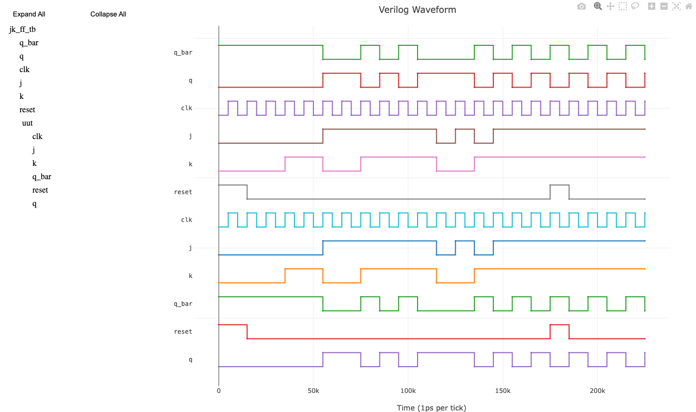

# Verilog Waveform Simulator

Run an Icarus Verilog testbench and inspect its signals in VS Code. The waveform viewer works offline after installation.



## Get started

If you have a pilot `.vsix`, open the VS Code Extensions view, choose **Install from VSIX** from the menu, and select the file. Download or clone this repository to get the sample projects.

1. Install [Icarus Verilog](https://steveicarus.github.io/iverilog/usage/installation.html) on the machine where VS Code runs the extension. For a WSL or SSH workspace, install it in that environment. On a shared lab computer, ask the lab administrator to provide Icarus Verilog.
2. In the VS Code terminal, check that `iverilog -V` and `vvp -V` both run. If you install the tools while VS Code is open, restart VS Code so it picks up the updated PATH.
3. Open `samples/jk_flipflop/jk_ff.v` or `jk_ff_tb.v` in a trusted workspace. Right-click the editor and choose **Generate Waveform**.
4. Expand `jk_ff_tb` and its `uut` scope to inspect `clk`, `reset`, and `q`. This testbench starts with reset asserted and releases it at 15 ns.

## Run your own design

- Use saved `.v` or `.sv` files. For automatic pairing, put `design.v` and `design_tb.v` in the same directory. A self-contained testbench can also be simulated by itself.
- Write one VCD with a relative filename such as `$dumpfile("wave.vcd");` and record your testbench with `$dumpvars(0, design_tb);`. End a finite test with `$finish;`. A sample is available in [`jk_ff_tb.v`](samples/jk_flipflop/jk_ff_tb.v).
- Compilation starts in the source directory. Simulation starts in a fresh temporary directory. Testbench file paths used at runtime, including paths passed to `$readmemh`, resolve from that temporary directory when relative. Use an absolute path for a required input file and a relative path for the VCD output.
- **Regenerate VCD File** reruns the same simulation. Both commands display the result from the current run. Generated files are temporary.
- Use **Clear Environment Cache** to rediscover the tools if their paths change. You can also set `IVERILOG_PATH` and `VVP_PATH` to executable paths in the environment that launches VS Code.
- Check the **Verilog Simulator** output channel for compiler or runtime diagnostics. You can cancel a run from its progress notification or adjust the per-phase limit with `verilogSimulator.timeoutSeconds` in VS Code settings.

## Develop and test

Run `npm ci`, then press **F5** to run the extension in a VS Code Extension Development Host. With Icarus Verilog available, run `npm run test:simulation` for the parser and real simulator tests. Run `npm test` for those tests plus the VS Code command tests.

Released under the [MIT License](LICENSE).

## Configure a multi-file lab

An instructor can commit the following settings in `.vscode/settings.json`. With this profile active, either waveform command runs the same assignment from any saved HDL source in that workspace folder.

```json
{
  "verilogSimulator.project": {
    "sources": ["rtl/counter.sv", "tests/counter_tb.sv"],
    "top": "counter_tb",
    "language": "2012",
    "includeDirectories": ["rtl/include"],
    "defines": ["WIDTH=8"],
    "inputFiles": ["data/initial.hex"],
    "dumpFile": "waves/counter.vcd"
  }
}
```

Each field is optional. The simulator copies listed input files into the run directory at the same relative paths for tasks such as `$readmemh`. Set the testbench's `$dumpfile` to the configured dump filename. In a testbench with no waveform instrumentation, add this inside the top-level module, replacing `counter_tb` with its name.

```verilog
initial begin
    $dumpfile("waves/counter.vcd");
    $dumpvars(0, counter_tb);
end
```
